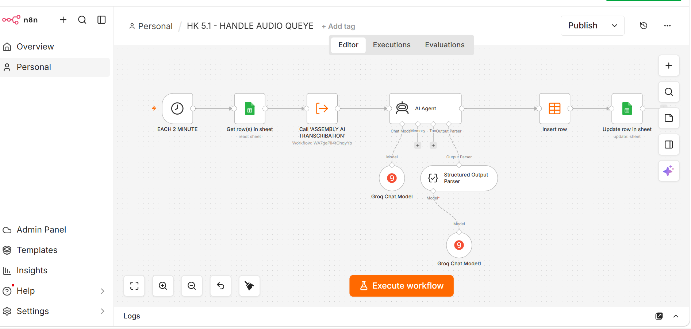
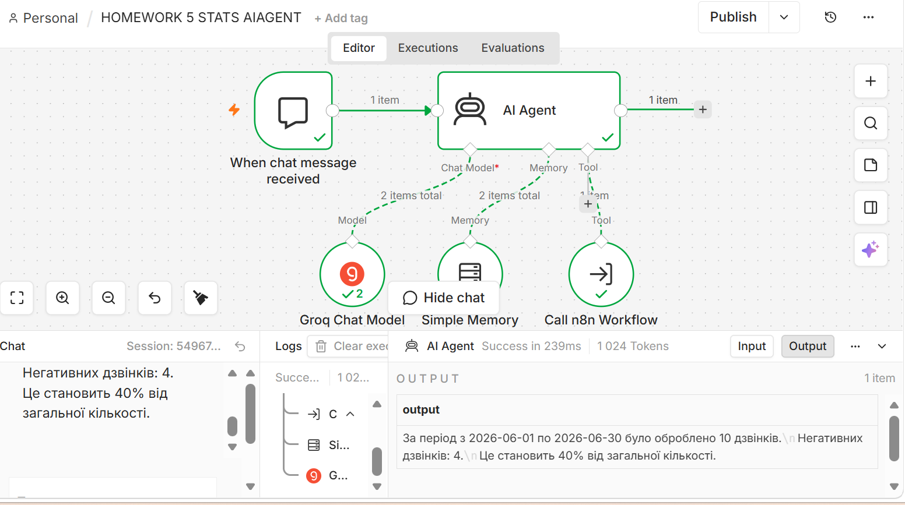
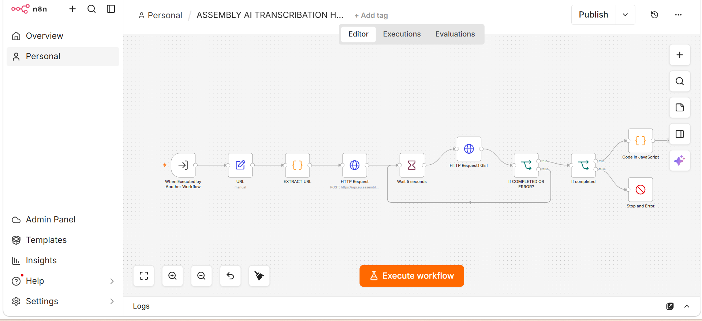
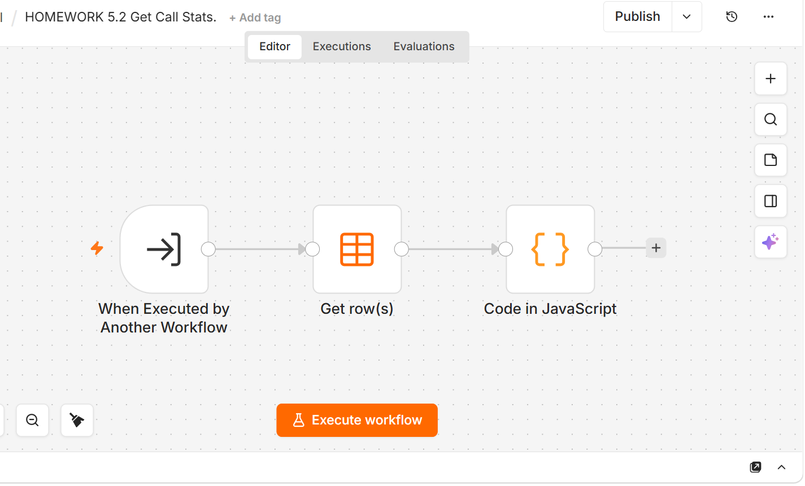
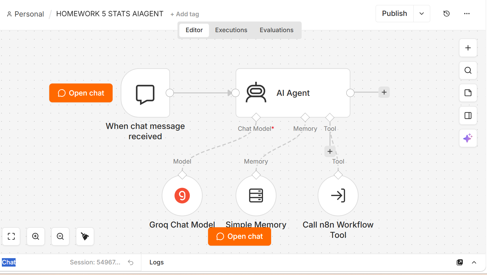
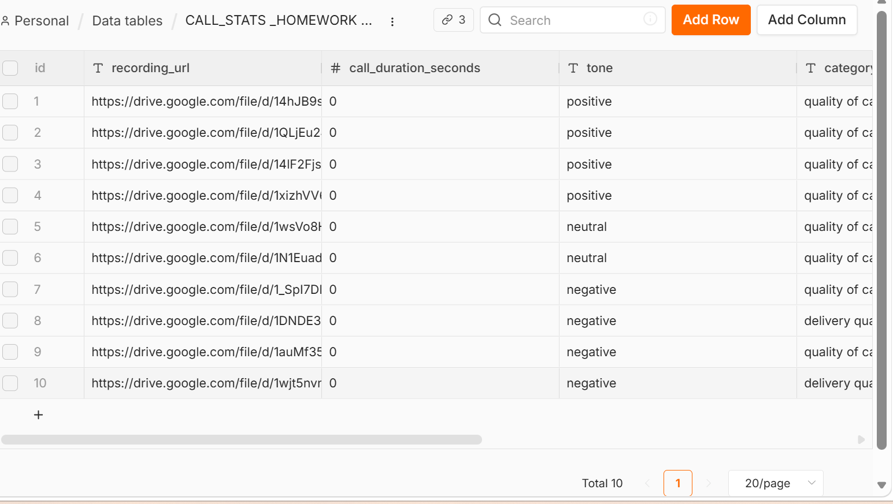

# AI Call Analytics for a Bakery - Complaint Statistics on Request

**n8n · AssemblyAI · Groq LLM · Google Sheets · n8n Data Tables · AI Agent**

Customer calls transcribed and analyzed automatically. A manager asks "How many complaints last month?" and gets the answer in seconds.

> Training project (GoIT AI Automator) based on a realistic bakery scenario.

## Problem

A bakery / cake shop receives calls about cake quality, delivery and general questions. Managers had to:

- listen to every call recording
- judge the customer's sentiment
- classify the complaint
- count negative feedback by hand

Slow, hard to scale, and management decisions were delayed.

## Solution

4 connected n8n workflows:

| # | Workflow | What it does |
|---|---|---|
| 1 | `1-handle-audio-queue.json` | Every 2 minutes takes the next unprocessed call link from Google Sheets → transcription → AI analysis (tone + category) → saves the result to a Data Table → marks the row as Done |
| 2 | `2-assemblyai-transcription.json` | Sub-workflow: Google Drive link → AssemblyAI (Ukrainian, 2 speakers) → waits until ready → builds a "Manager / Client" dialog |
| 3 | `3-get-call-stats.json` | Tool: returns `totalCalls`, `negativeCalls`, `negativeCallPercent` |
| 4 | `4-stats-ai-agent.json` | Chat AI agent: understands "this month", "last month", explicit dates (current date is passed in the system prompt) → calls the stats tool → answers in plain language |

**AI analysis returns strict JSON:**
- tone: `positive` / `negative` / `neutral`
- category: `quality of cake` / `delivery quality` / `other`

## Results

- 4 interconnected workflows working as one system
- 10 test calls processed automatically
- 4 negative calls detected (40%)
- 100% automated statistics - no manual listening and counting
- Answers in plain language for any period

## Screenshots

**AssemblyAI transcription (sub-workflow)**

**Get call stats (tool)**

**Stats AI agent**

**Data Table with analyzed calls**

## How to use

1. In n8n: **Workflows → Import from file** → import all 4 JSON files
2. Connect your own credentials: Google Sheets, AssemblyAI (HTTP Header Auth), Groq
3. Create an n8n Data Table with columns: `recording_url`, `call_duration_seconds`, `tone`, `category`
4. Replace placeholders:
   - `YOUR_GOOGLE_SHEET_ID` - queue sheet with columns `recording_url`, `status`, `dialog`
   - `YOUR_DATA_TABLE_ID`
   - `YOUR_TRANSCRIPTION_WORKFLOW_ID` - ID of workflow 2 (used in workflow 1)
   - `YOUR_GET_CALL_STATS_WORKFLOW_ID` - ID of workflow 3 (used in workflow 4)
5. Add call recording links (Google Drive, "anyone with the link") to the sheet and activate the workflows

**Next improvement:** filter Data Table rows by `startDate` / `endDate` inside the stats tool (currently it counts all stored calls).

No API keys or personal data are included in this repository.

## Author

**Petro Volkov** - AI Automation for Logistics & Sales
[Upwork](https://www.upwork.com/freelancers/~01bf694cbbacdc6c7d) · [Portfolio](https://app.notion.com/p/Petro-Volkov-AI-Automator-39aa3189d4e1803ab7ece06f01930819) · [LinkedIn](https://linkedin.com/in/petro-volkov-5a576b87)
